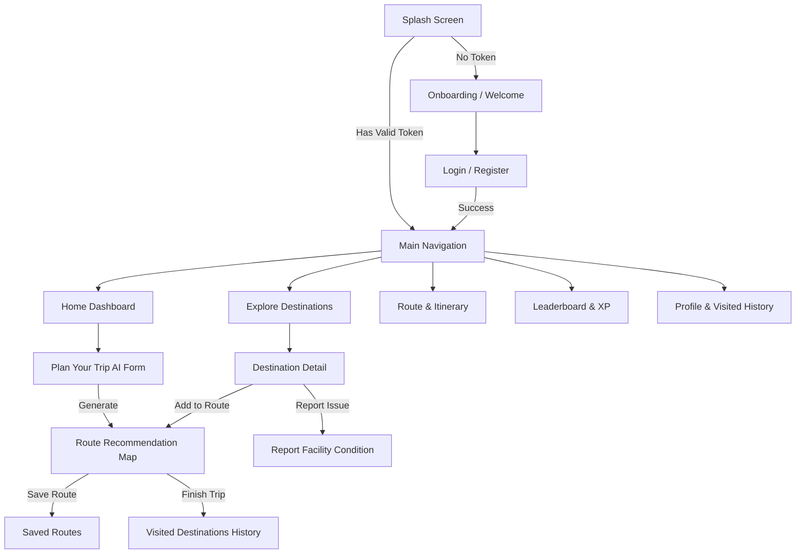

# MOYA Mobile — AI-Powered Accessible Tourism Platform

<p align="center">
  
</p>

<p align="center">
  <b>Empowering Inclusive Tourism Through Smart Accessibility Recommendations, Interactive Route Planning, and Community-Driven Insights.</b>
</p>

<p align="center">
  
  
  
  
</p>

---

## Table of Contents

- [About MOYA](#-about-moya)
- [Key Features](#-key-features)
- [Tech Stack & Dependencies](#-tech-stack--dependencies)
- [Architecture & Directory Structure](#-architecture--directory-structure)
- [Getting Started](#-getting-started)
  - [Prerequisites](#prerequisites)
  - [Installation & Setup](#installation--setup)
  - [Running the App](#running-the-app)
- [API Configuration](#-api-configuration)
- [Core Application Flows](#-core-application-flows)
- [Contributing](#-contributing)
- [License](#-license)

---

## About MOYA

**MOYA** is an inclusive smart tourism mobile application built with Flutter. It is designed to remove barriers for travelers with disabilities, senior tourists, and families by providing reliable information on verified accessibility facilities, smart Decision Support System (DSS) itinerary recommendations, live GPS route visualization, and a gamified crowdsourced facility reporting system.

---

## Key Features

### 1. AI-Powered Route Recommendation (DSS)
- **Multi-Constraint Optimization**: Generates personalized travel itineraries based on selected accessibility needs, tourism categories, budget limits, and available time duration.
- **Multiple-Choice Accessibility Filters**: Filter places with ramps, elevators, wheelchair-accessible restrooms, disabled parking, tactile guiding blocks, and braille guides.
- **Real-Time Geolocation Anchoring**: Calibrates recommendations based on the user's live coordinates in Batam and surrounding regions.

### 2. Interactive Maps & Waypoint Routes
- **OpenStreetMap & FlutterMap**: Fully interactive map canvas supporting polyline rendering, sequenced stop markers, and dynamic map centering.
- **Draggable Itinerary Sheet**: Smooth, responsive bottom sheet containing full route details, cost estimates, estimated time, and stop management.
- **Custom Route Builder**: Add any destination directly from the catalog, reorder or remove stops, and preview custom routes instantly.

### 3. Accessible Destinations Catalog
- **Live Search & Category Filtering**: Browse and search curated destinations by tourism categories (Culinary, Nature, Cultural, Shopping, Religious, etc.).
- **Accessibility Badges**: Instant visual indicators for verified accessible amenities at each attraction.
- **Detailed Destination Profiles**: Comprehensive information including operational hours, entrance fees, facilities, photos, and verified visitor reviews.

### 4. Crowdsourced Facility Reporting & Reviews
- **Destination-Specific Facility Reports**: Report damaged, obstructed, or unavailable accessibility facilities with photo proof and status tags.
- **Photo Evidence Upload**: Integrated camera and gallery picker with multipart HTTP upload.
- **Inclusive Reviews & Ratings**: Submit detailed accessibility feedback and read verified reviews from other travelers.

### 5. Gamification & Contributor Leaderboard
- **XP & Achievement Badges**: Earn experience points for submitting verified condition reports, writing reviews, and completing travel itineraries.
- **Rank Tiering**: Progress through tiers (*Bronze, Silver, Gold, Platinum*) and climb the community leaderboard.

### 6. 💾 Seamless Data Persistence & Offline-First Navigation
- **Saved Routes**: Bookmark and save generated itineraries to access anytime offline.
- **Trip Completion & History**: Finish trips to automatically record visited spots to user profile statistics.
- **Auto-Login & Session Security**: Persistent JWT authentication and intelligent splash screen routing.

---

## Tech Stack & Dependencies

| Category | Technology |
|---|---|
| **Framework** | [Flutter](https://flutter.dev) (v3.29.0+) |
| **Language** | [Dart](https://dart.dev) (v3.7.2+) |
| **Mapping & GIS** | `flutter_map: ^8.3.1`, `latlong2: ^0.10.1`, `geolocator: ^14.0.2` |
| **Networking** | `http: ^1.6.0` (RESTful APIs, Multipart Form Data) |
| **Local Storage** | `shared_preferences: ^2.5.3` |
| **Media & Assets** | `image_picker: ^1.2.1` |
| **Typography & UI** | `google_fonts: ^6.3.2` (Inter Font Family), Custom Moya Design System |

---

## Architecture & Directory Structure

The project follows a **Feature-Driven Modular Architecture**:

```text
lib/
├── app/
│   ├── routes.dart                 # Centralized route definitions and transitions
│   └── theme.dart                  # Global Moya color palette and typography
├── core/
│   ├── constants/
│   │   └── api_constants.dart      # Base URLs and endpoint paths
│   ├── services/                   # RESTful API client services
│   │   ├── accessibility_service.dart
│   │   ├── auth_service.dart
│   │   ├── destination_service.dart
│   │   ├── leaderboard_service.dart
│   │   ├── notification_service.dart
│   │   ├── profile_service.dart
│   │   ├── rank_service.dart
│   │   ├── report_service.dart
│   │   ├── review_service.dart
│   │   ├── route_service.dart
│   │   └── tourism_service.dart
│   └── utils/
│       ├── dialog_utils.dart       # Unified status, confirmation, and error dialogs
│       └── session_utils.dart
└── features/
    ├── auth/                       # Login, Register, Welcome, and Token management
    ├── destinations/               # Destination catalog and rich detail pages
    ├── home/                       # Dashboard, search, featured picks, and category grid
    ├── leaderboard/                # Contributor rankings, XP, and badge showcase
    ├── main_navigation/            # Bottom navigation bar with persistent tab state
    ├── notification/               # Push & system notification feed
    ├── onboarding/                 # First-time user onboarding slides
    ├── profile/                    # User statistics, visited history, saved routes, settings
    ├── report/                     # Accessibility condition photo reporting form
    ├── route_recommendation/        # AI route planner form and map itinerary viewer
    └── splash/                     # Startup auto-login and session validation
```

---

## 🚀 Getting Started

### Prerequisites
- [Flutter SDK](https://docs.flutter.dev/get-started/install) (version `3.29.0` or higher)
- [Dart SDK](https://dart.dev/get-dart) (version `3.7.2` or higher)
- Android Studio / VS Code with Flutter extensions
- Android Device or Emulator (API 24+) / iOS Simulator (iOS 13+)

### Installation & Setup

1. **Clone the Repository:**
   ```bash
   git clone https://github.com/lilChiie/Moya-Frontend-Mobile.git
   cd Moya-Frontend-Mobile
   ```

2. **Install Dependencies:**
   ```bash
   flutter pub get
   ```

3. **Verify Environment:**
   ```bash
   flutter doctor
   ```

### Running the App

- **Run on Connected Device/Emulator:**
  ```bash
  flutter run
  ```

- **Run in Release Mode:**
  ```bash
  flutter run --release
  ```

- **Run Static Analysis:**
  ```bash
  flutter analyze
  ```

---

## API Configuration

All endpoint paths and base URLs are defined in [`lib/core/constants/api_constants.dart`](file:///d:/moya_mobile/lib/core/constants/api_constants.dart):

```dart
class ApiConstants {
  static const String baseUrl = 'https://YOUR_BACKEND_URL.ngrok-free.app';
  
  static const String login = '/api/auth/login';
  static const String register = '/api/auth/register';
  static const String destinations = '/api/destinations';
  static const String recommendation = '/api/recommendation';
  static const String routes = '/api/routes';
  static const String reports = '/api/reports';
  static const String leaderboard = '/api/leaderboard';
}
```

> **Note**: If running a local backend via Ngrok or local network, update `baseUrl` with your active tunnel URL.

---

## 🔄 Core Application Flows



---

## Contributing

Contributions, issues, and feature requests are welcome!

1. Fork the project.
2. Create your feature branch (`git checkout -b feature/AmazingFeature`).
3. Commit your changes (`git commit -m 'Add some AmazingFeature'`).
4. Push to the branch (`git push origin feature/AmazingFeature`).
5. Open a Pull Request.

---

## License

For Batam Singapore 2026 Hackathon Submission.


---

<p align="center">
  Made with 💚 for Accessible and Inclusive Tourism.
</p>
